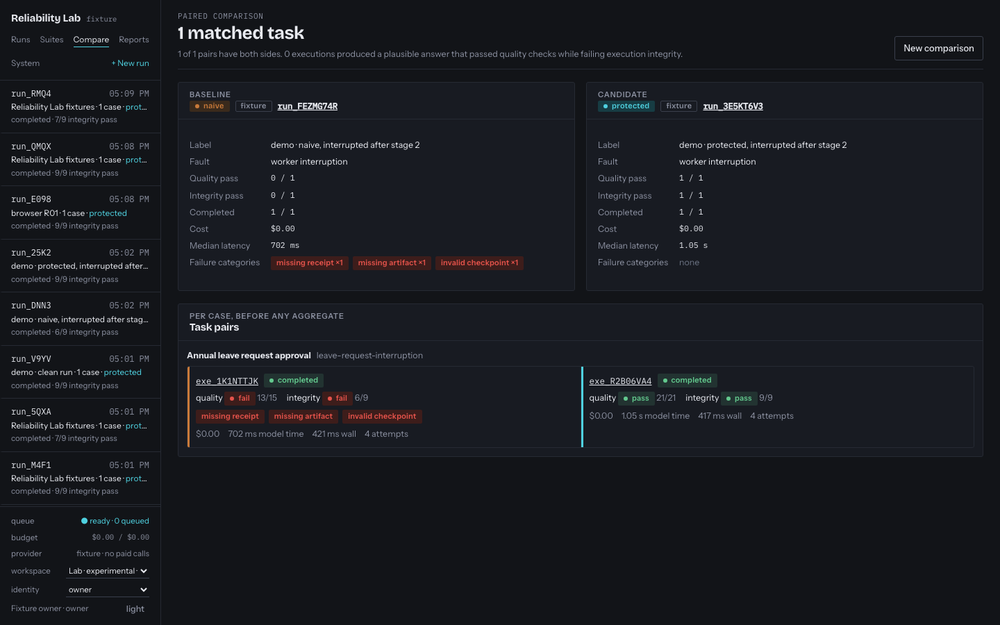

# Agent Reliability Lab

**What survives when an AI job goes wrong?**

A convincing answer can hide a broken run. Agent Reliability Lab runs the same task through naive and protected workers so output quality and execution integrity can be examined separately.

Built by **Mohammed Abumtary** · TypeScript · React · Hono · PostgreSQL · durable workers

[Demo guide](docs/DEMO.md) · [Engineering notes](docs/ENGINEERING.md) · [Verification & boundaries](docs/VERIFICATION.md) · [Recorded walkthrough](media/walkthrough.webm)

## The experience

Choose a task → inject a fault → compare runs → inspect integrity and output.

Controlled fault experiments over fictional requirements and a deterministic fixture provider. The default demo makes no paid model calls.

## Where the engineering matters

### Commit acceptance atomically

The protected runner writes an idempotency receipt with the queued run. Repeating the same request returns the original run; a changed intent conflicts.

### Make ownership expire safely

Workers publish under leases and owner tokens. Checkpoints are reusable only when their content, input and configuration digests match.

### Judge the run independently

Verification checks receipts, publication ownership, checkpoint integrity and artifact freshness separately from answer quality. Comparisons retain failed runs.

## Verified in the demonstration

- 18 database regressions covering replay, ownership, interruption, checkpoints and verification boundaries.
- Five browser checks passed for the current demo.
- Recorded walkthrough includes controlled fault injection and inspection of the resulting evidence.

## Explore the work

This repository is a presentation package: screenshots, walkthrough media and engineering notes. Application source, credentials and customer records are not included. The interactive demonstration runs in a separate local review environment; access can be arranged for a walkthrough.

[Read the guided demo](docs/DEMO.md) · [View my portfolio](https://mohammed-ab.github.io/)

## Scope

Fixture faults demonstrate specific failure modes; they are not a benchmark of all real models or an availability guarantee. The baseline is intentionally unsafe inside the experiment only.

Reviewed 10 November 2026. Results describe the recorded build and stated test scope.
